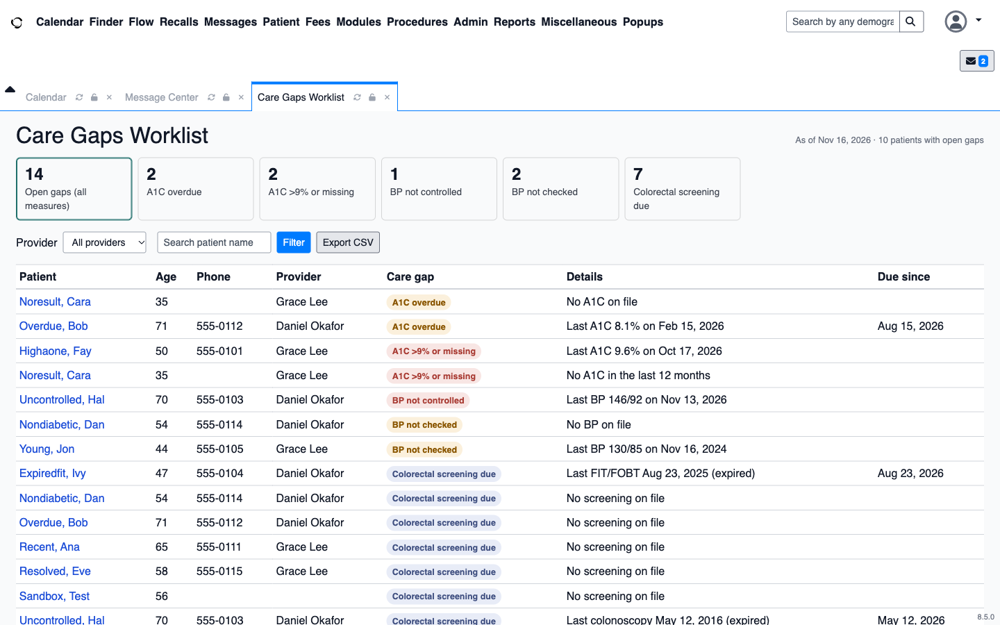
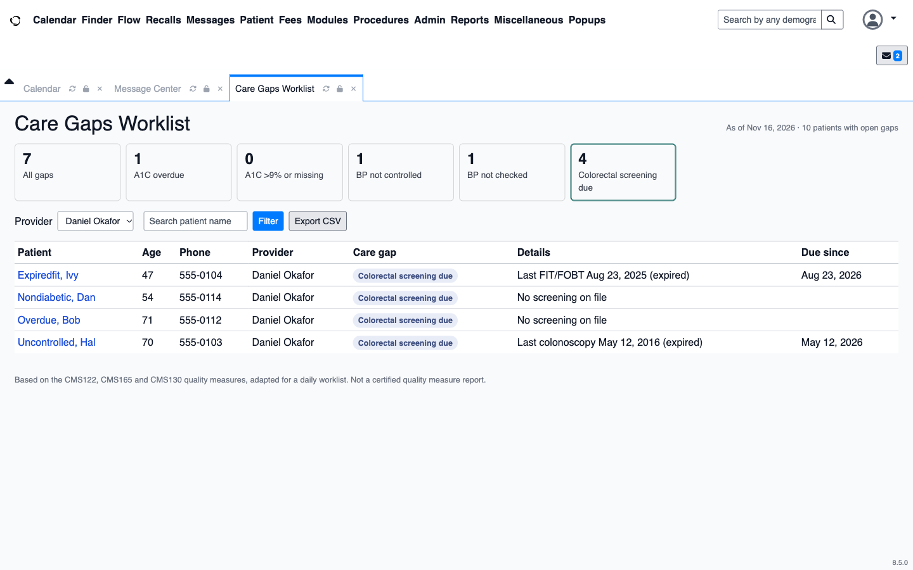

# Care Gaps Worklist for OpenEMR

One list of every patient with an open care gap, so front-desk and care-team staff know whom to call today.



## What it flags

| Gap | Who is checked | Flagged when |
|---|---|---|
| A1C overdue | Patients 18-75 with active diabetes (ICD-10 E10, E11, E13) | No A1C in the last 6 months |
| A1C >9% or missing | Same | Latest A1C in the last 12 months is above 9%, or there is none |
| BP not controlled | Patients 18-85 with active hypertension (ICD-10 I10) | On the most recent day with a reading, the lowest systolic is 140+ or the lowest diastolic is 90+ |
| BP not checked | Same | No blood pressure in the last 12 months |
| Colorectal screening due | Patients 45-75 without colorectal cancer, a history of it, or a colectomy (C18-C20, Z85.038, Z85.048, Z90.49) | No screening still valid: colonoscopy 10 years, CT colonography or flexible sigmoidoscopy 5, stool DNA 3, FIT/FOBT 1 |

The rules follow the CMS122, CMS165 and CMS130 quality measures, adapted for a daily worklist. This is not a
certified quality measure report.

Screenings are found wherever practices record them: lab results (LOINC), procedure orders and billing
(CPT/HCPCS), and surgery history (a code, or a title such as "Colonoscopy"). All codes live in
`src/Measures/MeasureCodes.php`.

## Why not OpenEMR's built-in reminders

Checked on OpenEMR 8.5.0:

- Clinical Reminders work one patient at a time; there is no list across all patients.
- The built-in hypertension rule matches only ICD-9 codes, so a patient coded with ICD-10 `I10` is never flagged.
- The built-in colon cancer rule starts at age 50 (current US guidance: 45) and only counts a manually ticked
  "screening done" assessment, not colonoscopy or stool-test results.

## Using it

**Reports > Care Gaps Worklist**

- Cards at the top show how many patients have each gap; click one to filter.
- Filter by provider or search by patient name.
- Click a patient's name to open their chart.
- **Export CSV** downloads the current list (name, age, phone, provider, gap, details) for phone or text
  outreach. Each export is recorded in OpenEMR's audit log.



Only users with access to patient medical records and demographics (`patients` / `med` and `demo`) can open the
page or export. Viewing and exporting are both recorded in OpenEMR's audit log, with counts only and no patient
names or search text.

The page shows the first 500 rows; the CSV export always has every row.

## Known limitations

- Problems are read from ICD-10 codes on the problem list. A condition recorded only as SNOMED CT or free text is not seen.
- Hospice, palliative care, end-stage renal disease and frailty exclusions from the CMS measures are not applied yet.
- Lab results must be coded with LOINC (or ordered with a recognised code). A1C values reported in mmol/mol, or
  outside 3-20%, are treated as having no usable value.
- Future-dated entries (planned procedures, mistyped dates) are ignored until their date arrives.

## Install

Requires OpenEMR 8.x and PHP 8.2+. The module adds no database tables and changes no settings.

1. Download this repository and copy it to `interface/modules/custom_modules/oe-module-vicert-care-gaps`
   in your OpenEMR install:
   ```bash
   cd /path/to/openemr/interface/modules/custom_modules
   git clone https://github.com/vicert-healthcare/oe-module-vicert-care-gaps.git
   ```
2. In OpenEMR go to **Modules > Manage Modules**, find **Care Gaps Worklist**, click **Install**, then **Enable**.
3. Log out and back in so the Reports menu picks up the new item.

## Development

Unit tests cover every rule and edge case (90 tests, 99% line coverage of the plain-PHP code). Run them inside the OpenEMR container, from this folder:

```bash
composer install
vendor/bin/phpunit
```

Measure rules (`src/Measures`), domain types (`src/Domain`), parsing helpers (`src/Support`) and the worklist
service (`src/Service`) are plain PHP with no OpenEMR dependency. Only `src/Repository/ClinicalDataRepository.php`
and the pages in `public/` talk to OpenEMR. The repository runs one query per data type across all patients,
never one per patient, and binds every value as a parameter.

## License

GNU General Public License 3, the same as OpenEMR. See [LICENSE](LICENSE).

## About

Built and maintained by [Vicert](https://vicert.ai), a healthtech engineering company that helps practices
install, upgrade, host and extend OpenEMR. Questions, bugs and ideas: please open an issue in this repository.
